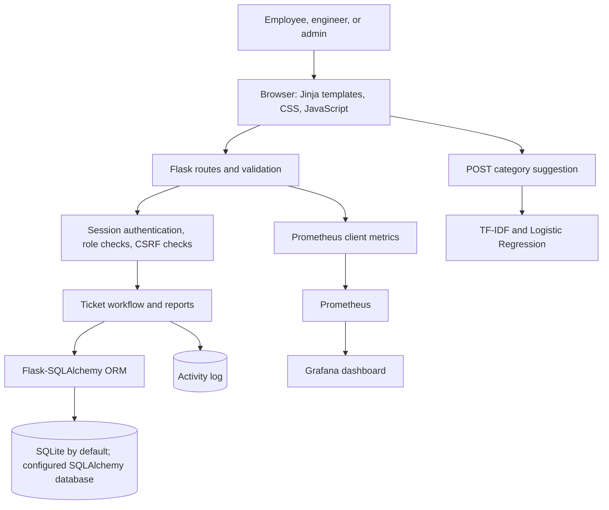

# Architecture

## Application flow



## Components

- **Frontend:** Flask renders Jinja pages in `templates/`. `static/css/style.css`
  provides the responsive design and `static/js/main.js` adds progressive
  enhancements; ticket category suggestion uses a small inline script.
- **Flask backend:** `app.py` handles page routes, input validation, ticket
  lifecycle actions, search/filter/sort, and report queries.
- **Authentication and authorization:** Werkzeug password hashes are checked
  at login. Flask's signed session stores the authenticated user ID; route
  decorators load the user and enforce employee, engineer, or admin access.
  POST forms are checked for a session CSRF token.
- **Database:** `models.py` defines `User`, `Ticket`, and `ActivityLog` using
  Flask-SQLAlchemy. SQLite is the local default; `DATABASE_URL` can select
  another SQLAlchemy-supported database. No migration framework is included.
- **Startup:** `render_start.py` creates missing tables but does not insert
  sample users or tickets unless `SEED_DEMO_DATA=1` is explicitly set for an
  isolated demo.
- **ML classifier:** `ml_classifier.py` trains a TF-IDF + Logistic Regression
  pipeline on the small in-code sample dataset. Prediction only suggests a
  category; the user keeps control of the form value.
- **Monitoring:** Prometheus metrics are exposed at `/metrics`, collected
  according to `monitoring/prometheus.yml`, and visualized by the supplied
  Grafana dashboard.
- **Testing:** Pytest tests use in-memory SQLite and cover routes, workflows,
  authorization, configuration, metrics, and classifier behavior.

## Request and monitoring paths

```text
Browser -> Flask route -> validation and role checks -> SQLAlchemy -> database
                                      |                    |
                                      +-> Jinja response <-+

Ticket description -> TF-IDF -> Logistic Regression -> optional category suggestion

Flask request -> Prometheus client -> /metrics -> Prometheus -> Grafana
```

This diagram describes the checked-in implementation; it does not imply a
separate frontend service, message queue, or production deployment.
