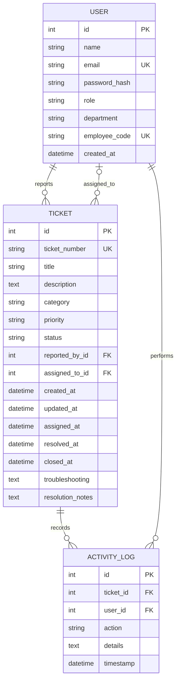

# Database

The schema is defined in `models.py`. SQLAlchemy's `db.create_all()` is used
to create missing tables; it is not a schema migration system. The project
does not automatically drop tables or reset existing rows. The default local
database is `instance/helpdesk.db`, while tests use in-memory SQLite.

## Entity relationships

## Models and values

- **User (`ticket_user`):** account identity, unique email, Werkzeug password
  hash, department, optional unique employee code, and role.
- **Ticket (`ticket`):** unique human-readable ticket number, subject and
  description, category, priority, lifecycle status, reporter and optional
  engineer foreign keys, lifecycle timestamps, and optional troubleshooting
  and resolution notes.
- **ActivityLog (`activity_log`):** ticket and actor foreign keys, action,
  optional details, and timestamp. Ticket activity is ordered chronologically
  by the model relationship; the detail page renders it newest first.

Allowed roles: `employee`, `engineer`, `admin`.

Allowed categories: `Hardware`, `Software`, `Network`, `Printer`,
`Account/Login`, `Security`, `Other`.

Allowed priorities: `Low`, `Medium`, `High`, `Critical`.

Allowed statuses: `Open`, `Assigned`, `In Progress`, `Resolved`, `Closed`.
`Open`, `Assigned`, and `In Progress` are treated as active statuses.

The application does not currently have a dedicated migration tool. Back up
data before manually changing a deployed schema.
